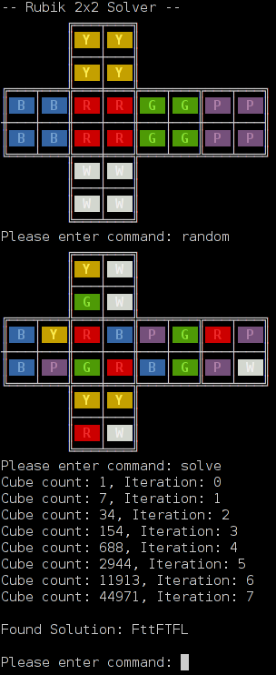

# pyRubik2x2

[](https://github.com/michaelkrisper/pyRubik2x2/actions/workflows/ci.yml)
[](https://github.com/michaelkrisper/pyRubik2x2/releases)
[](LICENSE)
[](https://www.python.org/)

A solver for the 2x2 Rubik's Cube - also known as the **Pocket Cube** or **Mini Cube** - running entirely in the terminal with a colored ANSI rendering of the cube.



## How it works

The solver combines a **breadth-first search** with a **pre-calculation step**:

1. All 24 orientations of the solved cube are generated as target states.
2. From those targets, every state reachable within `LEVEL_OF_PRECALCULATION` moves (default: `4`) is enumerated and cached.
3. A BFS from the scrambled state runs until it meets the cached set.

Meeting the cached set saves the last four levels of the search, which keeps the state space tractable without shipping a full pattern database. Solutions are short but not guaranteed to be optimal.

## Requirements

- Python 3.9 or newer - no third-party dependencies
- A terminal with ANSI color support

## Installation

```bash
git clone https://github.com/michaelkrisper/pyRubik2x2.git
cd pyRubik2x2
```

Nothing to build or install.

## Usage

### Interactive mode

```bash
python3 rubik.py
```

Starts with a solved cube and a prompt. Commands:

| Command | Effect |
| --- | --- |
| `l` / `L` | left layer down / up |
| `r` / `R` | right layer up / down |
| `t` / `T` | top layer left / right |
| `b` / `B` | bottom layer right / left |
| `f` / `F` | front face clockwise / anti-clockwise |
| `a` / `A` | back face clockwise / anti-clockwise |
| `random`, `random4` | scramble with 8 or 4 random moves |
| `init <state>` | load a cube state (format below) |
| `reset` | back to the solved cube |
| `print` | draw the cube again |
| `solve` | search and print a solution |
| `exit` | quit |

Moves can be chained, e.g. `lFtL`. Solutions use the moves `l L t T f F`.

### Solve a given state

```bash
python3 rubik.py rgrggpyybbppwwbrwwgpyyrb
```

Prints the cube, solves it and exits:

```
Found Solution: tF
```

A state is 24 letters, four per face in the order top, front, bottom, back, left, right.
Within a face the stickers are read row by row (top-left, top-right, bottom-left, bottom-right).
Colors: `y` yellow, `r` red, `w` white, `p` purple, `b` blue, `g` green. The solved cube is
`yyyyrrrrwwwwppppbbbbgggg`.

## Development

```bash
pip install pytest ruff
pytest      # run the test suite
ruff check  # lint
```

CI runs both on every push and pull request against Python 3.9 to 3.14.
Every merge to `main` is tagged with the next patch version; bundled releases
with release notes come from the Release workflow.

## Project structure

| File | Purpose |
|---|---|
| `rubik.py` | Entry point - interactive loop, pre-calculation, BFS solver |
| `cube.py` | `RubikCube` class - state representation, rotations, rendering |
| `test_rubik.py` | Unit tests for moves, parsing and the solver |
| `run.bat` | Convenience launcher for Windows |

## Contributing

Changes start with an issue and go through a pull request; see
[CONTRIBUTING](CONTRIBUTING.md).

## License

MIT - see [LICENSE](LICENSE).
